<div align="center">


<hr>

### Outbreak early warning for Sri Lanka, district by district.

[](#run-it)

Docker only · a few minutes to start · all case data simulated · [Demo accounts](#demo-accounts) · [Screenshots](#screenshots) · [Architecture](#architecture) · [Results](#results) · [API](docs/api.md)

[](https://github.com/Rimaz17/sentinel/actions/workflows/ci.yml) [](LICENSE) [](backend/api) [](backend/api) [](frontend) [](frontend) [](backend/detector)
<br>
[](docs/adr/0019-postgis.md) [](docs/adr/0014-kafka-between-ingestion-and-storage.md) [](docs/adr/0015-seven-day-windows-in-redis.md) [](docs/adr/0010-openstreetmap-tiles.md) [](infra/docker-compose.yml)

</div>

Sentinel gathers anonymised symptom reports from hospitals, clinics and
pharmacies across Sri Lanka, learns what a normal week looks like for each
district, and raises an alert when an area moves well outside that range: on
day three of an outbreak, not day ten. Public health inspectors see each alert
the moment it is raised, with where its reports are bunched on the map; the
public sees calm, district-level status and nothing that could identify anyone.

> **Status:** all seven build phases are built, and every pull request starts
> the whole stack in CI and checks it as far as the detector's first alerts. A
> public deployment is not up yet, so the demo runs locally with one command.
> **All case data is simulated; no real patient data is used.**

## Video walkthrough

Four minutes, narrated, with English captions, filmed on the full stack running
locally on its simulated data: why Sentinel exists and how it decides, the
public dashboard, a hospital registering and submitting a report, an inspector
confirming an outbreak with its 2 km ring, access refused outside an inspector's
district, administration, and the architecture.

https://github.com/user-attachments/assets/11814ede-2552-4384-a715-ee3d7fbd1536

## Screenshots

Taken from the full stack running locally on its simulated data.

<p align="center">
  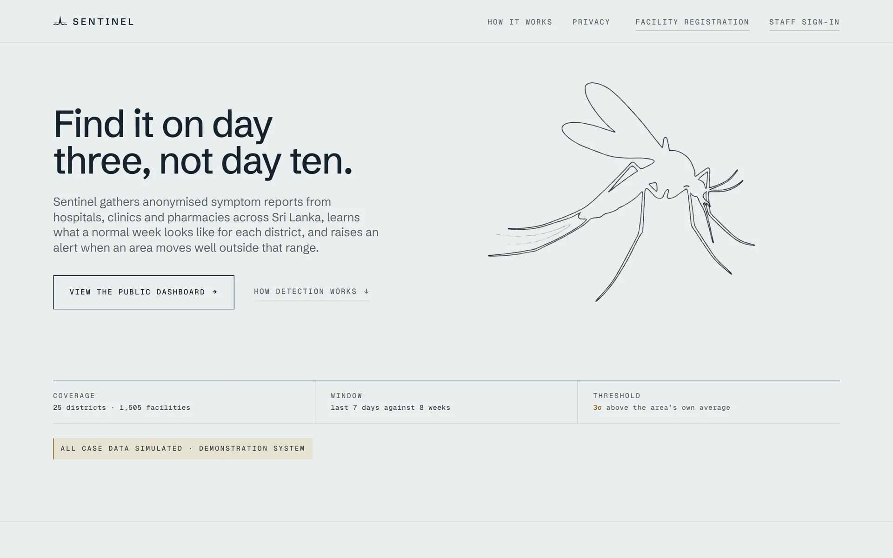
</p>
<p align="center"><b>Landing page</b> · the public entry point: what Sentinel is in one sentence, and one click to the public dashboard</p>

<table>
  <tr>
    <td width="50%">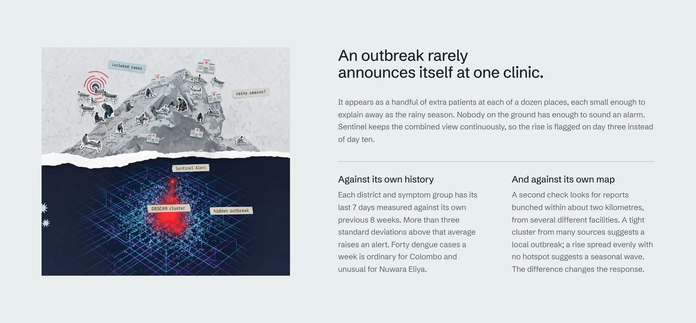</td>
    <td width="50%">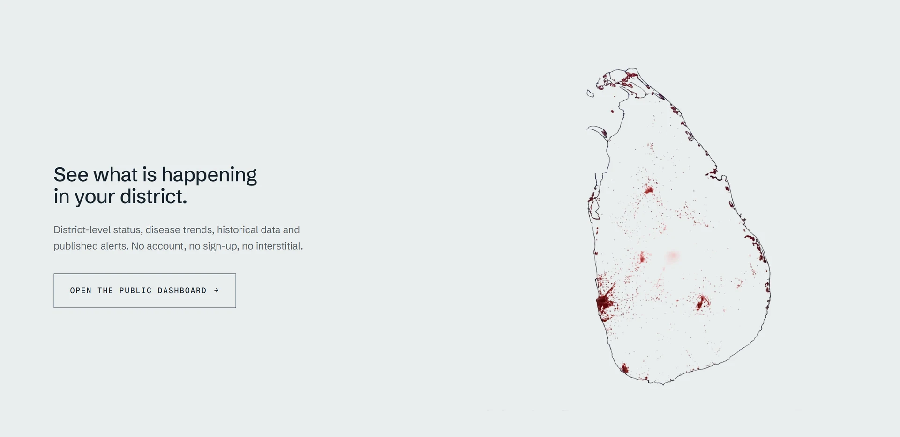</td>
  </tr>
  <tr>
    <td><b>How it works</b> · the two checks in plain words: each area against its own history, and against its own map</td>
    <td><b>The public route</b> · one click to the public dashboard, no account; the map is an illustration, not live data</td>
  </tr>
</table>

**Same data, two audiences.** The public sees the pattern; inspectors see the detail.

<table>
  <tr>
    <td width="50%">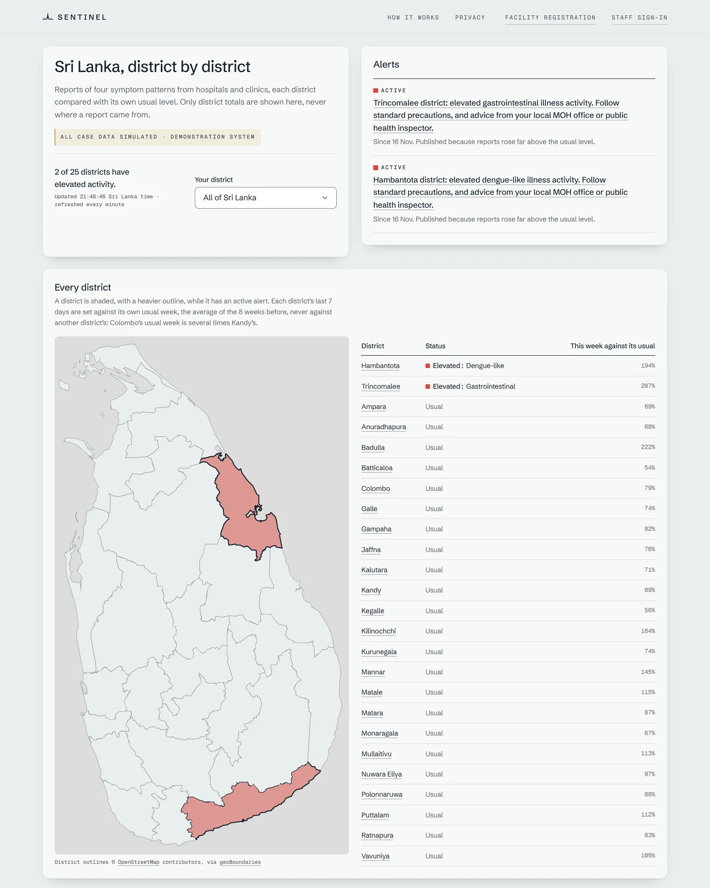</td>
    <td width="50%">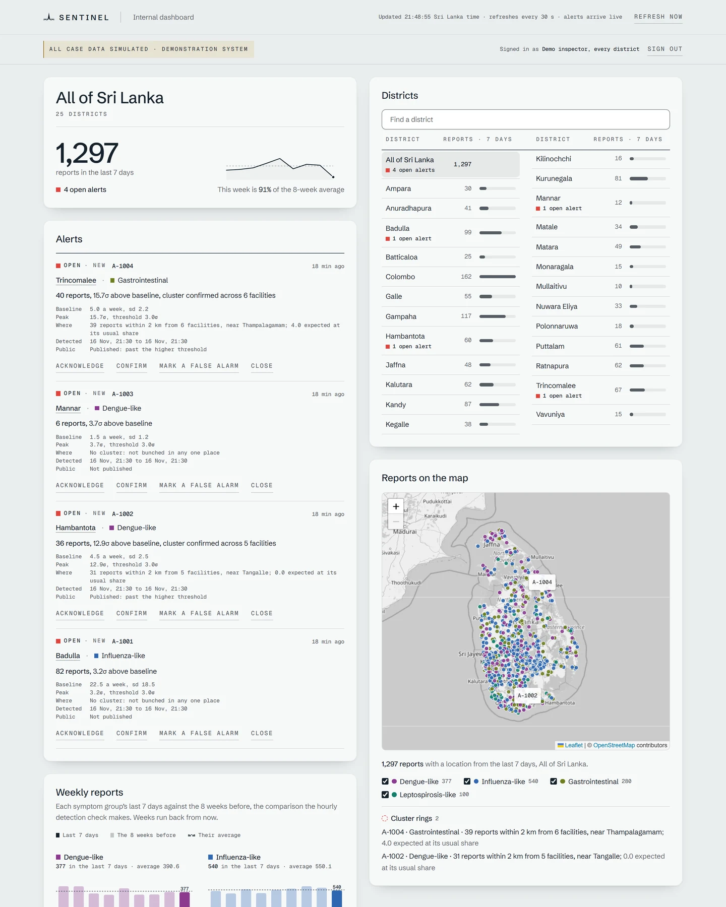</td>
  </tr>
  <tr>
    <td><b>Public dashboard</b> · district status and plain-language alerts, with no account; never a report's position or a facility</td>
    <td><b>Inspector dashboard</b> · technical alerts, every report as a dot, 2 km cluster rings; new alerts arrive live over WebSocket</td>
  </tr>
</table>

<p align="center">
  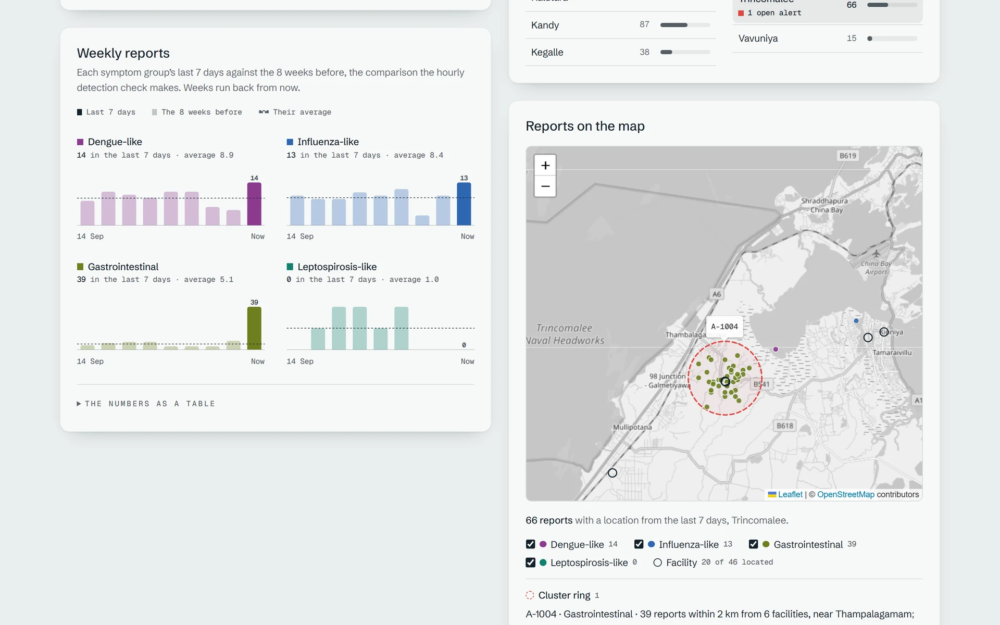
</p>
<p align="center"><b>A local outbreak, found</b> · Trincomalee's gastrointestinal reports at 39 against a usual 5.1 a week, 39 of them within 2 km from 6 facilities, so the alert carries a cluster ring</p>

<table>
  <tr>
    <td width="50%">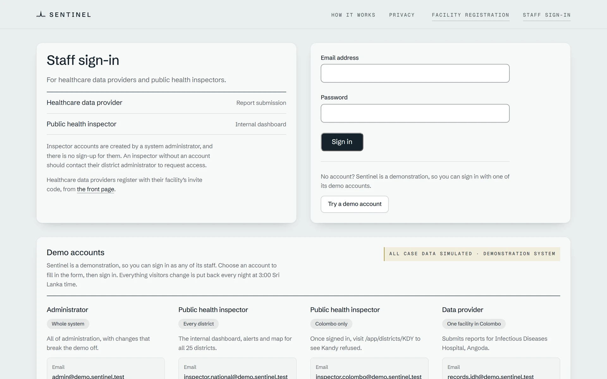</td>
    <td width="50%">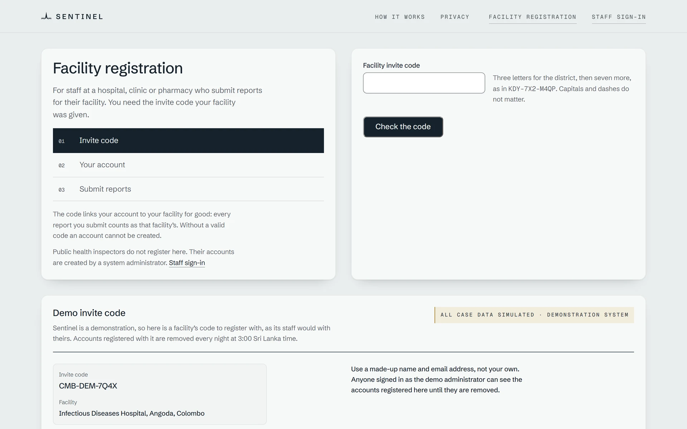</td>
  </tr>
  <tr>
    <td><b>Staff sign-in</b> · one sign-in for every staff role, with a demo account for each</td>
    <td><b>Facility registration</b> · data providers register only with their facility's invite code</td>
  </tr>
  <tr>
    <td>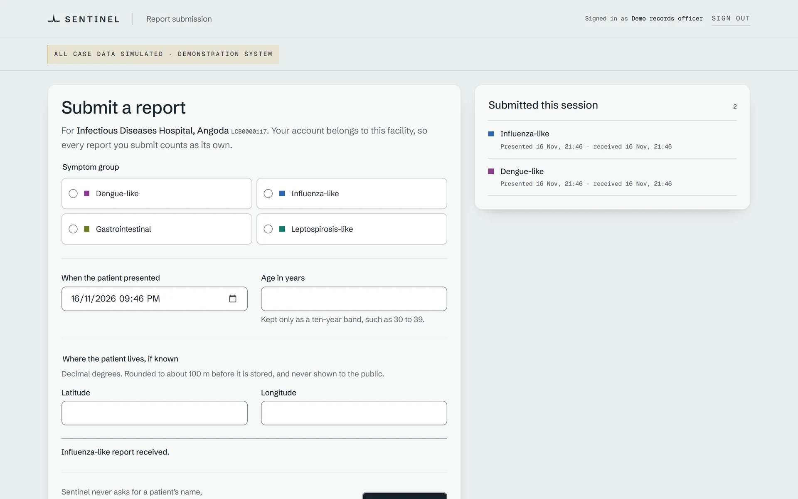</td>
    <td>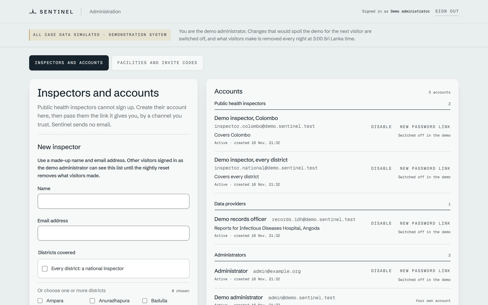</td>
  </tr>
  <tr>
    <td><b>Report submission</b> · never asks for a name, NIC number, birth date, phone or address</td>
    <td><b>Administration</b> · inspectors cannot sign up; an administrator creates them and issues facility invite codes</td>
  </tr>
</table>

**On a phone.** Every page works at phone width.

<table>
  <tr>
    <td align="center" width="25%">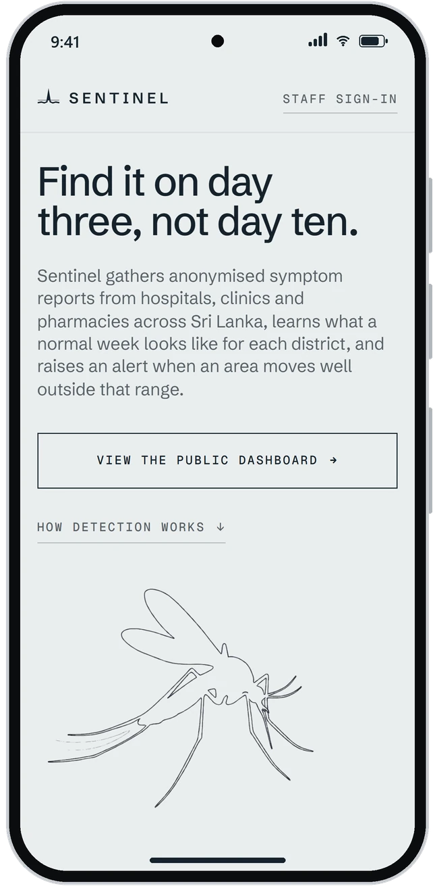</td>
    <td align="center" width="25%">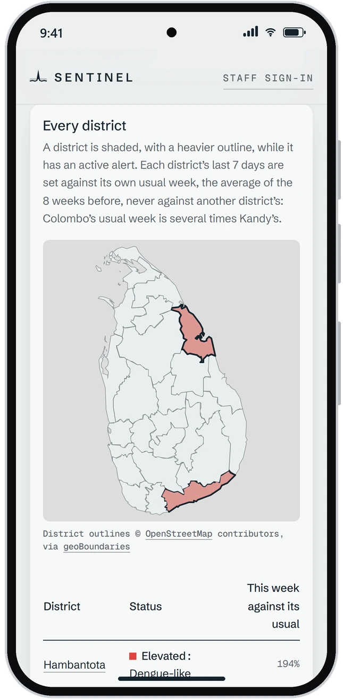</td>
    <td align="center" width="25%">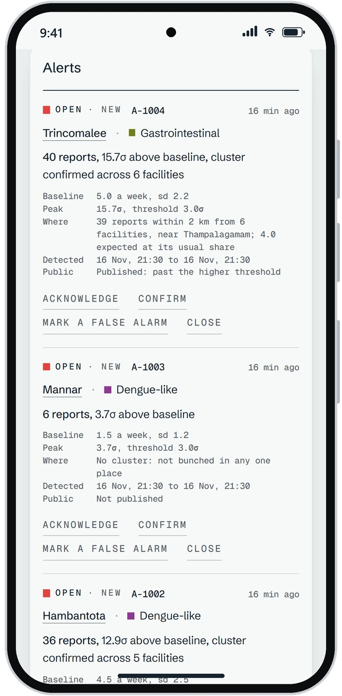</td>
    <td align="center" width="25%">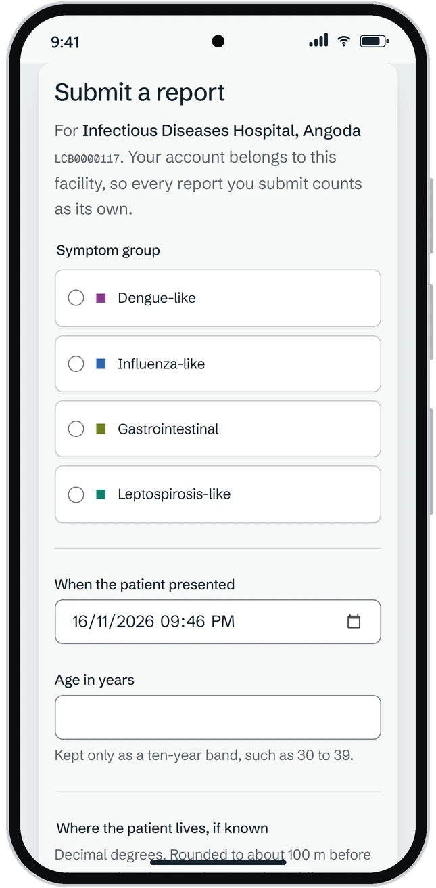</td>
  </tr>
  <tr>
    <td align="center"><b>Landing</b><br>What Sentinel is, for anyone</td>
    <td align="center"><b>Public dashboard</b><br>Every district, shaded by status</td>
    <td align="center"><b>Inspector alerts</b><br>The detail behind each alert</td>
    <td align="center"><b>Report submission</b><br>A report in a few fields</td>
  </tr>
</table>

## Architecture

![Sentinel's architecture in seven layers: users (the public, data providers, health inspectors and the administrator, in a React and Leaflet app); the nginx web gateway; the Spring Boot API with its auth, ingestion, facility registry, alerts, live push, public API and admin parts; Apache Kafka and the stream processor; PostgreSQL with PostGIS, Redis and Flyway; the Python detector and report simulator; and Docker, Docker Compose and GitHub Actions. A red arrow shows alerts pushed live to inspectors.](docs/architecture/sentinel-architecture-overview.png)

[The detailed diagram](docs/architecture/sentinel-architecture.svg) shows every
flow exactly. In words: a report enters the Spring Boot API, which strips its
identity and publishes it to Kafka; a stream processor stores it in PostgreSQL
with PostGIS and counts it in Redis; an hourly Python detector writes alerts,
which a database trigger announces to the API, which pushes them over WebSocket
to the inspectors who cover that district. nginx serves the React app and the
API on one origin.

## Why it exists

An outbreak rarely announces itself at one clinic. It shows up as a few extra
patients at each of a dozen places, each too few to raise an alarm: twelve
facilities around Kandy that usually see 25 dengue-like cases a week between
them see 87 in a simulated outbreak, but none sees more than eleven. Paper
returns bring the combined picture together about a week late. Sentinel keeps
it continuously and flags the rise on day three instead of day ten.

## How it works

- **Each area against its own history.** Every hour, each district and symptom
  group's last 7 days are compared with its previous 8 weeks; more than 3
  standard deviations above its average raises an alert. 40 dengue cases a week
  is normal for Colombo and alarming for Nuwara Eliya.
  ([ADR 0007](docs/adr/0007-detection-v1.md))
- **Where the reports bunch.** For each flagged series, DBSCAN looks for reports
  within 2 km from at least three facilities, well above that place's usual
  share. A ring on the map means a local outbreak; no ring, a district-wide
  wave. ([ADR 0020](docs/adr/0020-geographic-check.md))
- **Identity stops at the front door.** Names, NIC numbers, birth dates, phone
  numbers and addresses are dropped at ingestion; age becomes a 10-year band and
  location is rounded to about 100 m. Nothing downstream, logs and backups
  included, holds personal data.
- **Four kinds of user.** The public sees district-level status with no account,
  never a report's position, which could reveal which household got sick. Data
  providers register with their facility's invite code. Inspectors are created
  by an administrator and see only their districts, enforced in every query. A
  demo mode lets visitors try each role.
  ([ADR 0011](docs/adr/0011-accounts-tokens-and-district-scope.md),
  [ADR 0017](docs/adr/0017-public-demo-mode.md))
- **Real-time.** Kafka buffers reports between ingestion and storage, Redis
  holds each district's seven-day window, and alerts reach inspectors over
  WebSocket the moment they are raised.

## Results

Because the simulator decides when each outbreak starts, every figure below is
measured against ground truth, from actual runs (seed 2026, at the shipped 3 sd).

| Measure | Result |
|---|---|
| Injected outbreaks detected | 61%, and 89% of those that triple a district's usual week |
| Median time to detect | 140 hours |
| False alarms | 3.3 a week, across all 25 districts and 4 symptom groups |
| Local outbreaks given a 2 km ring, once alerted | 79% |
| District-wide waves wrongly ringed | 1% |
| Pipeline throughput | About 200 to 250 reports a second, on a laptop |
| Submission to stored and counted | About 20 ms (median), up to 200 reports a second |

Full tables, other seeds and what the numbers do and do not show:
[Measured results](docs/measurements.md).

## Run it

The whole system starts with one command. It needs only **Docker with Compose**
(Docker Desktop on Windows and macOS). From the repository root:

```bash
cp infra/.env.example .env
```

```bash
docker compose --env-file .env -f infra/docker-compose.yml --profile app up -d --build
```

The example settings work for a local look; for anything more, change the
passwords and secrets as `infra/.env.example` explains. The command returns once
nine weeks of simulated history are in (about 12,000 reports, a few minutes),
and the detector checks at once, so alerts are on the dashboards straight away.

Open **<http://localhost:8088>**. The public dashboard needs no account; the
sign-in page offers demo accounts for each staff role.

### Demo accounts

Every demo account signs in with the password `sentinel-demo`. The accounts and
the password are shown to every visitor on the sign-in page, on purpose
([ADR 0017](docs/adr/0017-public-demo-mode.md)), and a click on an account fills
the form.

| Account | Email | Reaches |
|---|---|---|
| Administrator | `admin@demo.sentinel.test` | All of administration, held back from what would break the demo |
| Inspector, every district | `inspector.national@demo.sentinel.test` | The internal dashboard for all 25 districts |
| Inspector, Colombo | `inspector.colombo@demo.sentinel.test` | Colombo only; Kandy answers 403 |
| Data provider | `records.idh@demo.sentinel.test` | Report submission for the Infectious Diseases Hospital, Angoda |

To register as a new data provider, use the demo invite code `CMB-DEM-7Q4X` at
`/register`. What visitors change is put back every night at 03:00 Sri Lanka time.

Stopped and started again, even weeks later, the stack fills in the reports it
missed while it was off before the live simulator and the detector start, so
the dashboards are current with no command to run: the start button in Docker
Desktop is enough ([ADR 0022](docs/adr/0022-backfill-fills-the-gap.md)).

| Command | What it does |
|---|---|
| `python scripts/smoke-test/smoke_test.py` | Checks the running stack end to end, as CI does |
| `docker compose --env-file .env -f infra/docker-compose.yml --profile app logs -f api` | Follows one service's log |
| `docker compose --env-file .env -f infra/docker-compose.yml --profile app down` | Stops everything, keeping the data; `down -v` deletes it too |

The stack uses about 1.2 GB of memory. To run each part on its own for
development, see [Developing Sentinel](docs/development.md).

## Stack

| Layer | Technology |
|---|---|
| API, auth, alerts | Spring Boot (Java 17), Maven |
| Detection, simulation | Python 3.12, pandas, scikit-learn |
| Event stream | Kafka |
| Database | PostgreSQL + PostGIS, Flyway |
| Live counters | Redis |
| Realtime | WebSocket (STOMP) |
| Frontend | React + TypeScript + Vite, Tailwind CSS, TanStack Query |
| Maps | Leaflet with OpenStreetMap tiles; no Google Maps, no API key, no billing |
| Web server | nginx |
| Delivery | Docker Compose, GitHub Actions |

Every pull request runs the tests, builds the four images, starts the whole
stack from them and smoke-tests it, as far as the detector's first alerts.

## Build status

| Phase | Scope | State |
|---|---|---|
| 1 | Walking skeleton: facility registry, simulator, ingestion API, PostgreSQL | **Built** |
| 2 | Detection v1: z-score baseline job writing alerts | **Built** |
| 3 | Dashboard v1: React + Leaflet | **Built** |
| 4 | Accounts and roles: invite codes, inspector accounts, public dashboard | **Built** |
| 5 | Real-time: Kafka, Redis windows, WebSocket alerts | **Built** |
| 6 | Geography: PostGIS, DBSCAN, cluster rings | **Built** |
| 7 | Ship it: Docker Compose, CI, deployed demo | **Built**, except the deployed demo |
| n/a | Landing page, the public entry point at `/` | **Built** |

## Known limitations

Documented on purpose; [the full list](docs/limitations.md) has 30.

- **Simulated data.** A real deployment would need Ministry of Health
  integration and ethical approval.
- **Shared invite codes.** One code per facility, so a leaked code could be
  reused; production would add per-user verification.
- **Facility data is from 2022,** and only 817 of its 1,501 facilities have a
  verified location.
- **Detection assumes a stable baseline.** A past epidemic would inflate
  "normal"; periodic recalibration would be needed.
- **Small or slow outbreaks are caught late or not at all**: 28% of those adding
  half again to a district's week are detected.
- **The full stack serves plain HTTP,** so a deployed demo needs HTTPS in front.

## Documentation

| Document | What is in it |
|---|---|
| [Developing Sentinel](docs/development.md) | Running each part on its own, demo accounts, injecting outbreaks, tests, CI, repository layout |
| [API](docs/api.md) | Every endpoint, public and internal |
| [Measured results](docs/measurements.md) | Detection, geography and pipeline measurements in full |
| [Known limitations](docs/limitations.md) | Every known limitation and trade-off |
| [Decision records](docs/adr/) | Why each significant choice was made |
| [Design](docs/design/) | The product and design system records |

## License

The code is released under the [MIT License](LICENSE). The data and fonts it
bundles keep their own licences: the facility registry is derived from Team
Watchdog's "Ministry of Health Institutions" dataset (Apache License 2.0); the
district outlines are OpenStreetMap data via geoBoundaries (Open Data Commons
Open Database License 1.0, © OpenStreetMap contributors); map tiles are ©
OpenStreetMap contributors; and the fonts, Schibsted Grotesk and Geist Mono, are
under the SIL Open Font License 1.1. The music in the video walkthrough is
"Inspired" by Kevin MacLeod (incompetech.com), licensed under Creative Commons
Attribution 4.0.

## Credits

Rimaz Saththar · BSc (Hons) Computer Science, University of Westminster / IIT Sri
Lanka · 2026.

Facility registry derived from the "Ministry of Health Institutions" dataset
published by Team Watchdog (databank.watchdog.team), sourced from Sri Lanka's
Ministry of Health.
